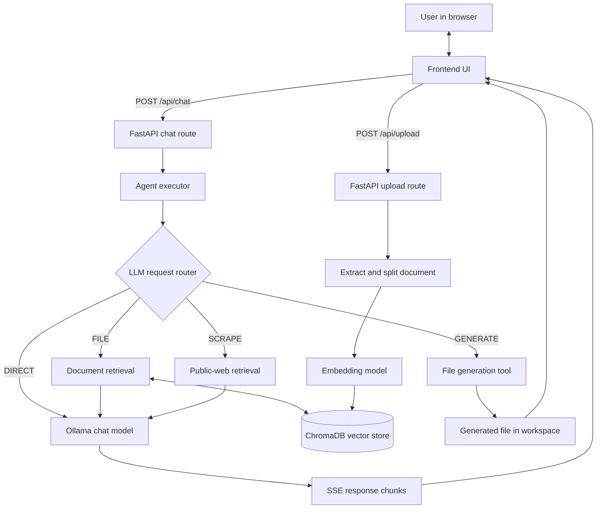
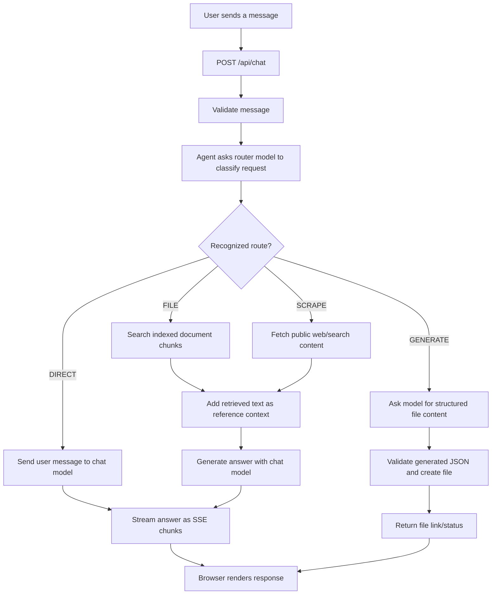
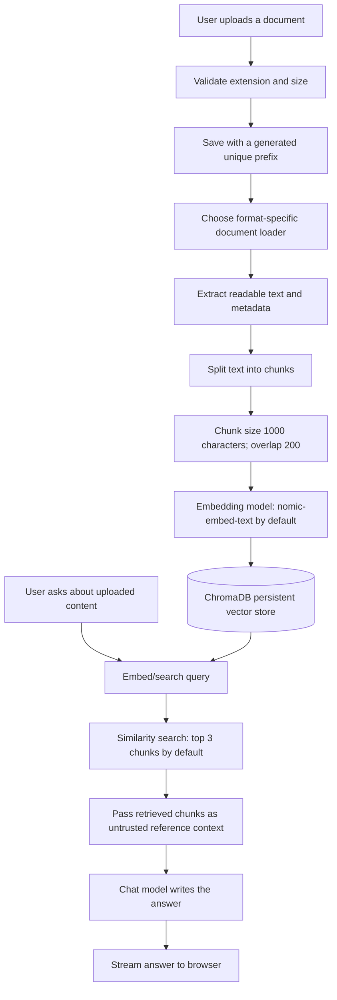

# AetherAI — Local-First AI Assistant

AetherAI is a local-first AI workspace built with **FastAPI, Ollama, LangChain, and ChromaDB**. It combines streamed chat, retrieval-augmented generation (RAG) over uploaded documents, public-web retrieval, and downloadable file generation in a lightweight browser UI.

The default chat model is `gemma2:2b`; the default embedding model is `nomic-embed-text`. Both can be changed through environment variables.

## Contents

- [Features](#features)
- [Architecture](#architecture)
- [How chat routing works](#how-chat-routing-works)
- [How document RAG works](#how-document-rag-works)
- [Web retrieval and file generation](#web-retrieval-and-file-generation)
- [Requirements](#requirements)
- [Installation and setup](#installation-and-setup)
- [Configuration](#configuration)
- [API reference](#api-reference)
- [Project structure](#project-structure)
- [Run tests and checks](#run-tests-and-checks)
- [Benchmark snapshot](#benchmark-snapshot)
- [Docker](#docker)
- [Security and privacy notes](#security-and-privacy-notes)
- [Known limitations](#known-limitations)

## Features

- **Local chat:** Ollama-powered answers streamed to the browser using Server-Sent Events (SSE).
- **Request routing:** The agent classifies requests as direct chat, uploaded-file questions, live-web retrieval, or file generation.
- **Document RAG:** Upload PDF, DOCX, CSV, XLSX, XLS, TXT, Markdown, JSON, or Python files for indexing and semantic retrieval.
- **Public-web retrieval:** Crawl4AI/Playwright-based extraction for public HTTP(S) pages and search queries.
- **Downloadable outputs:** Generate PDF, DOCX, CSV, TXT, Markdown, JSON, and supported code/web files.
- **Resource-aware defaults:** Best-effort RAM and NVIDIA VRAM detection.
- **Browser UI:** Static frontend served by FastAPI; no separate frontend build step is required.

## Architecture

The main application is organized into a browser frontend, FastAPI routes, an agent executor, an Ollama-backed language model, and specialized retrieval/file tools.



### Main components

| Component | Responsibility |
|---|---|
| `main.py` | Creates the FastAPI app, prepares runtime directories, mounts the frontend/static files and downloads, and starts Uvicorn. |
| `api/chat_routes.py` | Validates chat input, streams SSE events, validates and stores uploads, and calls document indexing. |
| `agent/executor.py` | Chooses a route, retrieves context when needed, invokes the model, and streams the answer. |
| `core/llm_setup.py` | Creates the configured Ollama chat and embedding clients. |
| `core/rag_pipeline.py` | Loads supported documents, splits text, indexes chunks in ChromaDB, and retrieves relevant chunks. |
| `core/config.py` | Loads environment configuration and defines model/runtime paths and limits. |
| `core/resource_manager.py` | Reports best-effort system memory and GPU resource information. |
| `tools/live_web_rag.py` | Retrieves content from public web pages/search results. |
| `tools/universal_file_ops.py` | Creates downloadable files in supported formats. |
| `benchmarks/benchmark_inference.py` | Measures Ollama generation latency, throughput, and resource information. |

## How chat routing works

Every chat request is first classified by the configured language model. The router is instructed to return one of four labels. If the response does not contain a recognized label, the executor falls back to direct chat.



| Route | Used for | What happens |
|---|---|---|
| `DIRECT` | General chat, coding, configuration, and non-current questions | The user's message is sent directly to the chat model. |
| `FILE` | Questions about an uploaded document | The query searches ChromaDB for up to three relevant chunks; retrieved text is supplied as reference context to the model. |
| `SCRAPE` | Current/live information or a supplied URL | Public web content is retrieved and supplied as reference context. Multiple URLs are processed with a configured concurrency limit. |
| `GENERATE` | Requests for a downloadable file | The model returns structured filename/content/reply data; the file tool creates the output and the route returns its status/link. |

The router is a lightweight LLM-based classifier, not a deterministic intent parser. Ambiguous requests may be routed incorrectly; rephrase the request if the chosen route is not appropriate.

## How document RAG works

RAG (retrieval-augmented generation) lets the assistant answer questions using relevant text from files you have indexed. The uploaded file is stored locally in the workspace; its extracted text is split into overlapping chunks and indexed with embeddings.



### Supported document types

| Extension | Loader |
|---|---|
| `.pdf` | PyPDF |
| `.docx` | Docx2txt |
| `.csv` | CSV loader with encoding detection |
| `.xlsx`, `.xls` | Unstructured Excel loader |
| `.txt`, `.md`, `.json`, `.py` | Text loader with encoding detection |

**Important:** Uploading a file indexes it; it does not automatically guarantee that every later question will retrieve the right passages. Ask a specific question about the uploaded content. Retrieval is similarity-based and depends on the quality of the extracted text and embedding model.

## Web retrieval and file generation

### Web retrieval

When a request is classified as `SCRAPE`, AetherAI extracts URLs from the message. If no URL is present, it builds a DuckDuckGo Lite search URL from the query. Retrieved content is passed to the model as reference material. Unavailable, blocked, or bot-protected sites may return no usable content.

### Downloadable files

For a `GENERATE` request, the model is asked for JSON containing a filename, file content, and a short reply. AetherAI validates the structure and delegates file creation to the file operations tool. Supported output extensions include `.pdf`, `.docx`, `.csv`, `.txt`, `.md`, `.json`, `.py`, `.js`, and `.html`.

Generated files are stored under the runtime workspace and served through `/downloads/<filename>`.

## Requirements

- Python 3.11 recommended.
- [Ollama](https://ollama.com/) installed and running locally.
- Chat model `gemma2:2b` and embedding model `nomic-embed-text` pulled in Ollama (or configure other models).
- Playwright Chromium installed for web retrieval.

## Installation and setup

### Windows PowerShell

```powershell
git clone https://github.com/Himanshu-mani/aether-ai.git
cd aether-ai
python -m venv .venv
.\.venv\Scripts\Activate.ps1
python -m pip install --upgrade pip
pip install -r requirements.txt
playwright install chromium
ollama pull gemma2:2b
ollama pull nomic-embed-text
python main.py
```

### Linux / macOS

```bash
git clone https://github.com/Himanshu-mani/aether-ai.git
cd aether-ai
python3 -m venv .venv
source .venv/bin/activate
python -m pip install --upgrade pip
pip install -r requirements.txt
playwright install chromium
ollama pull gemma2:2b
ollama pull nomic-embed-text
python main.py
```

Open **http://127.0.0.1:8000** if the browser does not open automatically. Keep Ollama running before chatting, indexing documents, or generating files. On first use, Ollama may need to load the configured model.

## Configuration

Copy `.env.example` to `.env` and edit values as needed. The application loads `.env` from the project root; environment variables already set by the shell/container take precedence.

| Variable | Default | Purpose |
|---|---|---|
| `OLLAMA_BASE_URL` | `http://localhost:11434` | Ollama API base URL |
| `MODEL_NAME` | `gemma2:2b` | Chat and routing model |
| `EMBEDDING_MODEL` | `nomic-embed-text` | Document/query embedding model |
| `DEFAULT_NUM_CTX` | `4096` | Fallback context window |
| `MAX_WEB_SCRAPE_CONCURRENCY` | `2` | Maximum concurrent web retrieval tasks |
| `MAX_UPLOAD_MB` | `20` | Maximum upload size |
| `HOST` | `127.0.0.1` | API bind address; Docker uses `0.0.0.0` |
| `PORT` | `8000` | API port |
| `AETHERAI_OPEN_BROWSER` | `1` | Set to `0` to disable automatic browser launch |
| `CORS_ALLOW_ORIGINS` | unset | Optional comma-separated origins for a separately hosted frontend |

## API reference

| Method | Endpoint | Input / output |
|---|---|---|
| `POST` | `/api/chat` | JSON body `{"message":"..."}`; returns an SSE stream with `chunk`, `done`, or `error` events. |
| `POST` | `/api/upload` | Multipart form with a `file` field; validates and indexes a supported document. |
| `GET` | `/downloads/<filename>` | Serves a generated file from the downloads workspace. |
| `GET` | `/` | Serves the browser UI. |

Example chat request:

```bash
curl -N http://127.0.0.1:8000/api/chat \
  -H "Content-Type: application/json" \
  -d '{"message":"Explain retrieval-augmented generation."}'
```

SSE data events contain JSON. A normal stream sends zero or more `chunk` events followed by `done`; failures may return an `error` event.

## Project structure

```text
aether-ai/
├── agent/
│   └── executor.py              # LLM-based request routing and response generation
├── api/
│   └── chat_routes.py           # Chat SSE endpoint and document upload endpoint
├── benchmarks/
│   └── benchmark_inference.py   # Ollama inference benchmark
├── core/
│   ├── config.py                # Environment and runtime configuration
│   ├── llm_setup.py             # Chat and embedding model clients
│   ├── rag_pipeline.py          # Document ingestion and retrieval
│   └── resource_manager.py      # RAM/GPU resource reporting
├── frontend/
│   ├── index.html               # Browser interface
│   ├── script.js                # Browser chat/upload behavior
│   └── style.css                # UI styles
├── tests/                       # Unit tests
├── tools/
│   ├── live_web_rag.py          # Public-web retrieval
│   └── universal_file_ops.py    # Downloadable file generation
├── workspace/                   # Runtime uploads, downloads, and vector data (not source code)
├── .env.example                 # Example environment configuration
├── Dockerfile
├── requirements.txt
└── main.py                      # FastAPI entry point
```

## Run tests and checks

Run these from the repository root with the virtual environment activated:

```bash
python -m unittest discover -s tests -v
python -m compileall -q main.py agent api core tools benchmarks tests
node --check frontend/script.js
```

These are local checks, not a guarantee that every integration works. Full feature verification requires installed Python dependencies, a running Ollama server with both models, and Playwright Chromium. After setup, manually test streamed chat, document upload and retrieval, web retrieval, and downloadable file generation. Report an integration test as passed only after it has actually run successfully.

## Benchmark snapshot

A recorded Ollama streaming benchmark on **2026-10-23** used `gemma2:2b`, a prompt of 38 tokens, and a maximum generation limit of 256 tokens. The run was on an NVIDIA GeForce RTX 2050 with 4 GB VRAM.

| Metric | Recorded result |
|---|---:|
| Prompt tokens | 38 |
| Generated tokens | 256 (configured cap reached) |
| Generated words | 199 |
| Client-observed time to first non-empty chunk | 2.4607 s (2460.74 ms) |
| Prompt evaluation | 0.3641 s |
| Generation duration | 4.7714 s |
| Generation throughput | 53.65 tokens/s |
| Ollama server total duration | 5.1636 s |
| Client total duration | 7.2391 s |
| `ollama ps` GPU placement | 100% GPU |
| Reported VRAM used / free | 2135 MB / 1830 MB |

This is a **single historical, machine-specific measurement**, not a general performance guarantee or a full application integration test. Generation reached the 256-token cap, so the output was truncated by the benchmark limit. Client-observed TTFT includes request/client overhead and is not pure model-compute latency. Run `python benchmarks/benchmark_inference.py` with Ollama available to measure your own system.

## Docker

Build and run:

```bash
docker build -t aetherai .
docker run --rm -p 8000:8000 \
  -e OLLAMA_BASE_URL=http://host.docker.internal:11434 \
  -v aetherai-workspace:/app/workspace \
  aetherai
```

The container includes Chromium. This example runs Ollama outside the container; configure the host address appropriately for your operating system and network. Keep persistent workspace data in a volume if you need uploads, generated files, and vector-store data to survive container removal.

## Security and privacy notes

- Chat and model inference use the configured Ollama endpoint. With a local Ollama server, model inference can remain on your machine; web retrieval still contacts public websites/search services when requested.
- Treat uploaded documents and retrieved webpage content as untrusted reference material.
- Uploads are restricted to supported extensions and a 20 MiB default limit. Runtime files and vector-store data are kept under `workspace/` and should not be committed.
- Web retrieval is intended for public HTTP(S) targets. Do not expose the application to untrusted networks without reviewing authentication, access controls, CORS, and network egress restrictions.
- Never commit secrets, private documents, generated user data, or a real `.env` file.

## Known limitations

- AI features require a running Ollama server and locally available configured models.
- The request router is model-based, so ambiguous prompts may be assigned the wrong route.
- Retrieval quality depends on extraction, chunking, embedding quality, and query wording.
- Web retrieval can fail on inaccessible, rate-limited, or bot-protected websites.
- Resource detection is best-effort; actual hardware allocation is controlled by Ollama and the runtime.
- PDF output uses a built-in Latin-1 font and may replace unsupported Unicode glyphs.
- The recorded benchmark is a single machine's observation and should not be compared across systems without matching model, prompt, generation limit, and hardware conditions.
