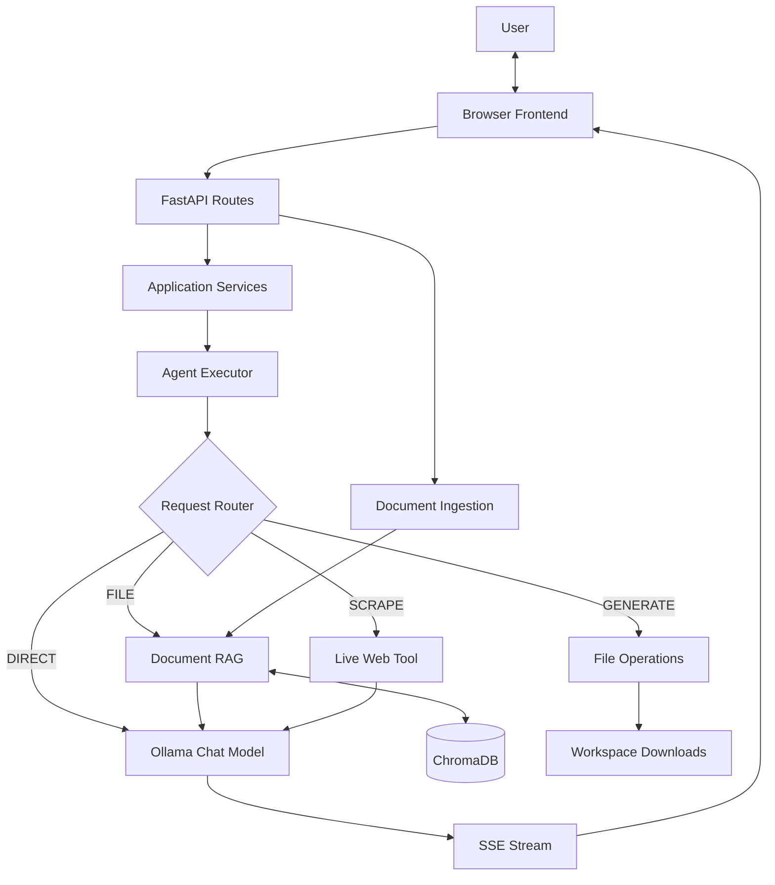

# AetherAI — Local-First AI Assistant

AetherAI is a local-first AI workspace built with **FastAPI, Ollama, LangChain, and ChromaDB**. It combines streamed chat, retrieval-augmented generation (RAG) over uploaded documents, live public-web retrieval, and downloadable file generation in a lightweight browser UI.

Default models: `gemma2:2b` for chat and `nomic-embed-text` for embeddings. Both are configurable through environment variables.

## Features

- **Local chat:** Ollama-powered answers streamed to the browser using Server-Sent Events (SSE).
- **Request routing:** The agent classifies requests as direct chat, uploaded-document questions, live-web retrieval, or file generation.
- **Document RAG:** Upload PDF, DOCX, CSV, XLSX, XLS, TXT, Markdown, JSON, or Python files for indexing and semantic retrieval.
- **Live Web:** Crawl4AI/Playwright-based extraction for public HTTP(S) pages and search queries.
- **File Operations:** Search indexed documents and generate downloadable PDF, DOCX, CSV, TXT, Markdown, JSON, and supported code/web files.
- **Resource-aware defaults:** Best-effort RAM and NVIDIA VRAM detection.
- **Browser UI:** Static frontend served by FastAPI; no separate frontend build step is required.

## Architecture

AetherAI follows a **modular-monolith architecture**. Responsibilities are separated into Python packages, but the application remains one deployable FastAPI service.



### Component responsibilities

| Package | Responsibility |
|---|---|
| `app/api/routes/` | Chat and document-upload HTTP endpoints. |
| `app/services/` | Chat streaming and document-upload use cases. |
| `app/agents/` | Request classification, prompts, and agent orchestration. |
| `app/rag/` | Document loading, chunking, ingestion, and semantic retrieval. |
| `app/tools/web_scraper.py` | Live retrieval from public web pages. |
| `app/tools/file_operations.py` | Search uploaded-file content through RAG and create downloadable outputs. |
| `app/llms/` | Ollama chat and embedding client factories. |
| `app/infrastructure/` | ChromaDB persistence adapter. |
| `app/monitoring/` | RAM/GPU resource detection and inference profile. |

**RAG, Live Web, and File Operations are separate responsibilities.** RAG handles uploaded and indexed documents; Live Web fetches public internet content when current information is requested; File Operations searches document content through the RAG retrieval interface and writes generated files.

## Request routing

| Route | Used for | What happens |
|---|---|---|
| `DIRECT` | General chat, coding, configuration, and non-current questions | Sends the user's message directly to the chat model. |
| `FILE` | Questions about an uploaded document | Retrieves up to three relevant chunks from ChromaDB as reference context. |
| `SCRAPE` | Current/live information or a supplied URL | Retrieves public web content and supplies it as reference context. |
| `GENERATE` | Requests for a downloadable file | Gets structured file data from the model and delegates writing to File Operations. |

The router is an LLM-based classifier, not a deterministic intent parser. Ambiguous requests may be routed incorrectly.

## Document RAG

1. Upload a supported document through the browser or `POST /api/upload`.
2. A format-specific loader extracts text and metadata.
3. Text is split into chunks of **1,000 characters** with **200-character overlap**.
4. The configured embedding model (default: `nomic-embed-text`) embeds the chunks.
5. Chunks are stored in the persistent ChromaDB workspace.
6. A `FILE` request retrieves the three most similar chunks by default and passes them to the chat model as untrusted reference context.

| Extension | Loader |
|---|---|
| `.pdf` | PyPDF |
| `.docx` | Docx2txt |
| `.csv` | CSV loader with encoding detection |
| `.xlsx`, `.xls` | Unstructured Excel loader |
| `.txt`, `.md`, `.json`, `.py` | Text loader with encoding detection |

Indexing a file does not guarantee every later question will retrieve the correct passage. Retrieval quality depends on extracted text, chunking, embeddings, and query wording.

## Live Web and File Operations

### Live Web

When a request is classified as `SCRAPE`, AetherAI extracts URLs from the message. If no URL is present, it queries DuckDuckGo Lite. Crawl4AI/Playwright extracts page text and passes it to the model as untrusted reference material. Inaccessible, rate-limited, or bot-protected pages may return no usable content.

### File Operations

For a `GENERATE` request, the model returns structured filename/content/reply data. The file tool validates the extension and writes the output under `workspace/downloads/`. Generated files are served through `/downloads/<filename>`.

## Project structure

```text
aether-ai/
├── app/
│   ├── agents/                 # Router, prompts, and agent executor
│   ├── api/routes/             # Chat and document HTTP routes
│   ├── core/                   # Environment and path configuration
│   ├── infrastructure/         # ChromaDB adapter
│   ├── llms/                   # Ollama model factories
│   ├── monitoring/              # RAM/GPU resource monitoring
│   ├── rag/                    # Loaders, chunking, ingestion, retrieval
│   ├── schemas/                # API request schemas
│   ├── services/               # Chat and document use cases
│   ├── tools/                  # Live Web and File Operations
│   └── main.py                 # FastAPI application
├── benchmarks/                 # Ollama inference benchmark
├── docs/                        # Architecture and development notes
├── frontend/                    # Static browser interface
├── tests/
│   ├── unit/                    # Isolated unit tests
│   └── integration/             # API contract tests
├── workspace/                   # Runtime uploads, downloads, and vector data
├── .env.example
├── Dockerfile
├── requirements.txt
└── main.py                      # Compatibility entry point
```

## Requirements and setup

- Python 3.11
- [Ollama](https://ollama.com/) installed and running locally
- Chat model `gemma2:2b` and embedding model `nomic-embed-text` pulled in Ollama (or configure other models)
- Playwright Chromium for Live Web

### Windows PowerShell

```powershell
git clone https://github.com/Himanshu-mani/aether-ai.git
cd aether-ai
python -m venv .venv
.\.venv\Scripts\Activate.ps1
python -m pip install --upgrade pip
pip install -r requirements.txt
playwright install chromium
ollama pull gemma2:2b
ollama pull nomic-embed-text
python main.py
```

### Linux / macOS

```bash
git clone https://github.com/Himanshu-mani/aether-ai.git
cd aether-ai
python3 -m venv .venv
source .venv/bin/activate
python -m pip install --upgrade pip
pip install -r requirements.txt
playwright install chromium
ollama pull gemma2:2b
ollama pull nomic-embed-text
python main.py
```

Open **http://127.0.0.1:8000** if the browser does not open automatically. Keep Ollama running before chatting, indexing documents, or generating files.

## Configuration

Copy `.env.example` to `.env`. Shell/container environment variables take precedence over values in `.env`.

| Variable | Default | Purpose |
|---|---|---|
| `OLLAMA_BASE_URL` | `http://localhost:11434` | Ollama API base URL |
| `MODEL_NAME` | `gemma2:2b` | Chat and routing model |
| `EMBEDDING_MODEL` | `nomic-embed-text` | Document/query embedding model |
| `DEFAULT_NUM_CTX` | `4096` | Fallback context window |
| `MAX_WEB_SCRAPE_CONCURRENCY` | `2` | Maximum concurrent web retrieval tasks |
| `MAX_UPLOAD_MB` | `20` | Maximum upload size |
| `HOST` | `127.0.0.1` | API bind address; Docker uses `0.0.0.0` |
| `PORT` | `8000` | API port |
| `AETHERAI_OPEN_BROWSER` | `1` | Set to `0` to disable automatic browser launch |
| `CORS_ALLOW_ORIGINS` | unset | Optional comma-separated origins for a separately hosted frontend |

## API reference

| Method | Endpoint | Description |
|---|---|---|
| `POST` | `/api/chat` | JSON body `{"message":"..."}`; returns SSE `chunk`, `done`, or `error` events. |
| `POST` | `/api/upload` | Multipart form with a `file` field; validates and indexes a supported document. |
| `GET` | `/downloads/<filename>` | Serves a generated file from the downloads workspace. |
| `GET` | `/` | Serves the browser UI. |

## Tests and checks

Run from the repository root with the virtual environment activated:

```bash
python -m unittest discover -s tests -v
python -m compileall -q app tests benchmarks main.py
node --check frontend/script.js
python -c "from app.main import app; print(app.title)"
```

Unit tests cover route normalization, chunking metadata, and resource-profile selection. The API contract test checks that the existing chat and upload paths are registered. Full integration verification still requires Ollama, the configured models, ChromaDB operations, and Playwright Chromium; static checks alone do not prove those services work.

## Benchmark snapshot

A recorded Ollama streaming benchmark on **2026-10-23** used `gemma2:2b`, a 38-token prompt, and a maximum generation limit of 256 tokens on an NVIDIA GeForce RTX 2050 with 4 GB VRAM.

| Metric | Recorded result |
|---|---:|
| Generated tokens | 256 (configured cap reached) |
| Client-observed time to first non-empty chunk | 2.4607 s |
| Prompt evaluation | 0.3641 s |
| Generation duration | 4.7714 s |
| Generation throughput | 53.65 tokens/s |
| Ollama server total duration | 5.1636 s |
| Client total duration | 7.2391 s |
| `ollama ps` GPU placement | 100% GPU |
| Reported VRAM used / free | 2135 MB / 1830 MB |

This is one historical, machine-specific measurement, not a general performance guarantee or a full application integration test. Generation reached the 256-token cap. Client-observed TTFT includes request/client overhead and is not pure model-compute latency. Run `python benchmarks/benchmark_inference.py` to measure your own system.

## Docker

```bash
docker build -t aetherai .
docker run --rm -p 8000:8000 \
  -e OLLAMA_BASE_URL=http://host.docker.internal:11434 \
  -v aetherai-workspace:/app/workspace \
  aetherai
```

The container includes Chromium. This example runs Ollama outside the container; configure the host address for your operating system and network. Use a persistent volume if uploads, generated files, and vector-store data must survive container removal.

## Security and privacy

- With a local Ollama endpoint, model inference can remain on your machine; Live Web contacts public websites/search services when requested.
- Treat uploaded documents and retrieved webpage content as untrusted reference material.
- Uploads are restricted by extension and a 20 MiB default limit. These checks are not malware scanning or content-type verification.
- The web scraper performs basic public-IP validation, but redirects and DNS changes can still create SSRF risk. Network-level egress controls and redirect validation are needed before exposing it to untrusted users.
- The application currently has no authentication layer. Keep it local or behind trusted access controls; review CORS and network exposure before deployment.
- Never commit secrets, private documents, generated user data, or a real `.env` file.

## Known limitations

- AI features require a running Ollama server and locally available configured models.
- The request router is model-based, so ambiguous prompts may be assigned the wrong route.
- Retrieval quality depends on extraction, chunking, embedding quality, and query wording.
- Web retrieval can fail on inaccessible, rate-limited, or bot-protected websites.
- Resource detection is best-effort; actual hardware allocation is controlled by Ollama and the runtime.
- PDF output uses a built-in Latin-1 font and may replace unsupported Unicode glyphs.
- The recorded benchmark is a single-machine observation and should not be compared across systems without matching model, prompt, generation limit, and hardware conditions.
